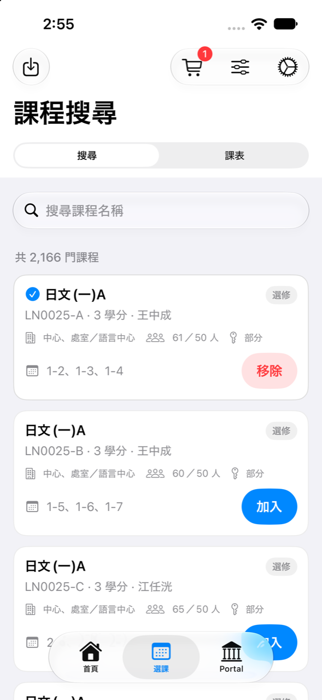
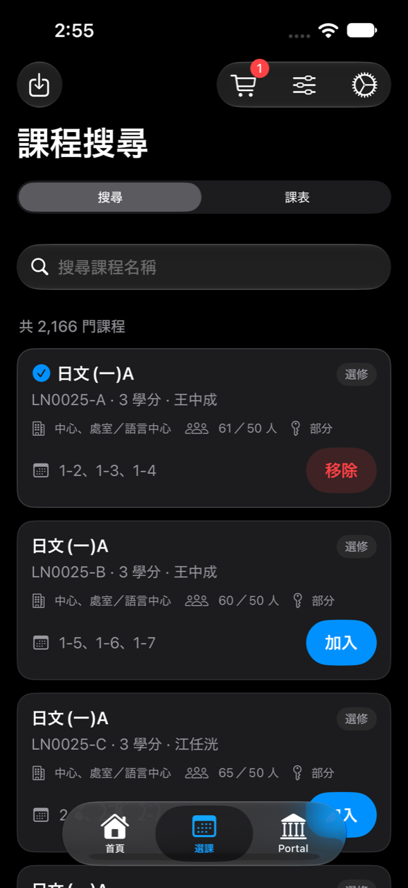
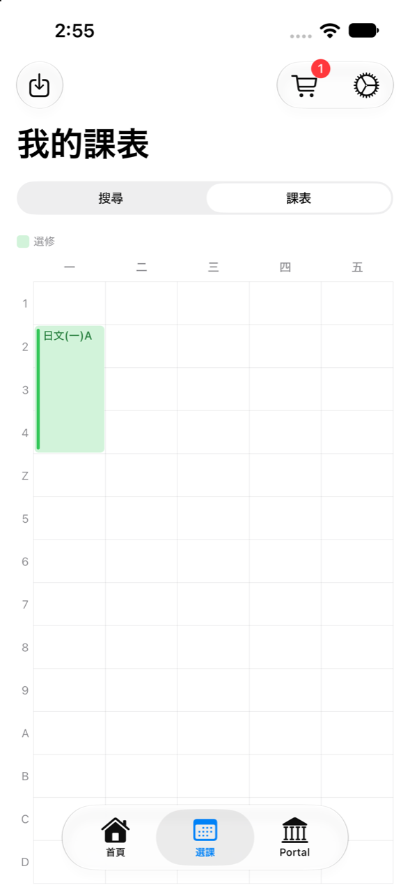
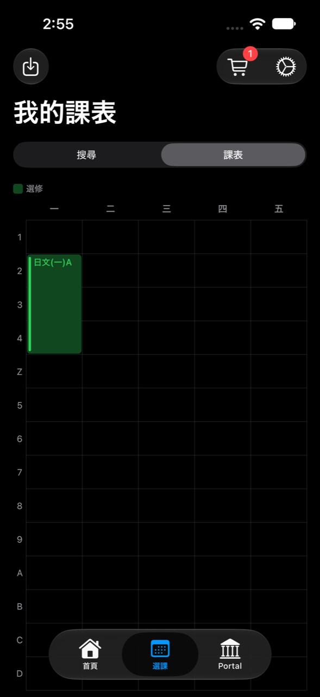
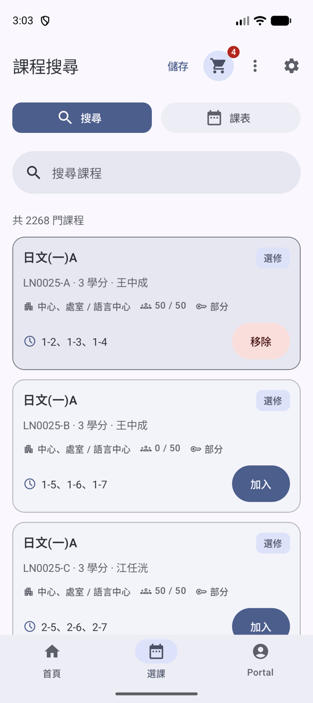
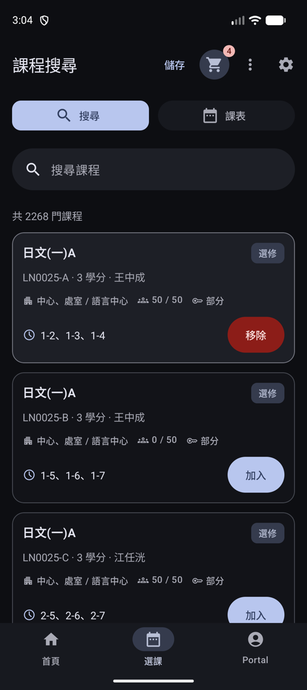
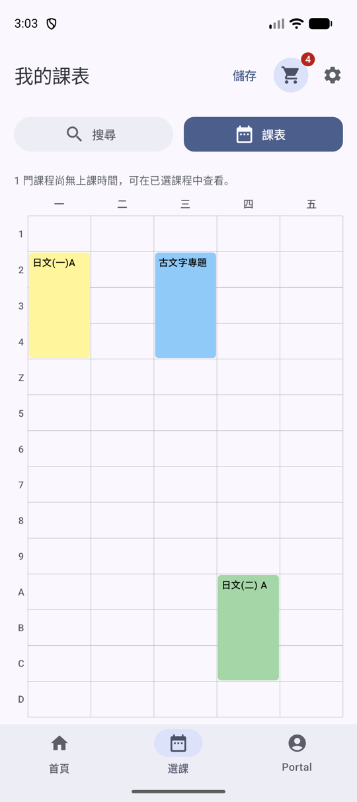
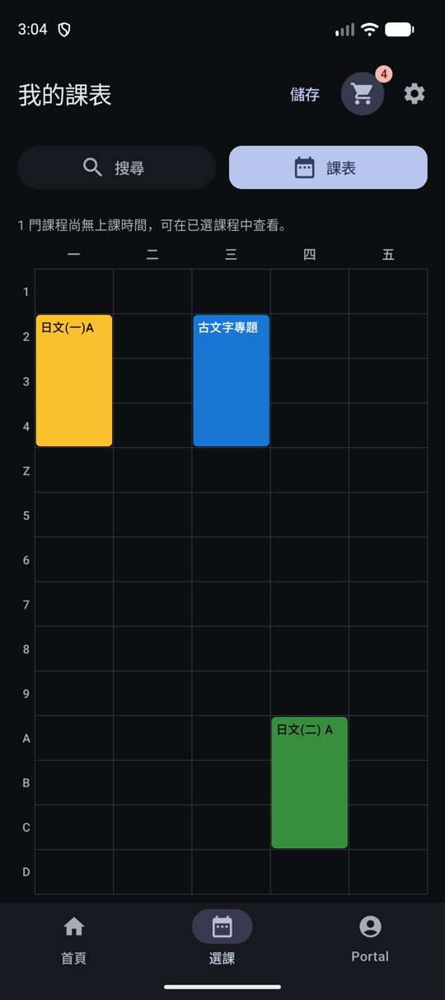

# Design system

The design system lives at https://claude.ai/artifact/NjeMw5HvVnqHVeWCcx44Db. Shared code names roles, and each platform resolves them to native values.

- `MpcTheme.colors`, `MpcTheme.typography`, `MpcSpacing`, and `MpcShapes` (`shared/src/commonMain/.../presentation/theme/`) are the only styling inputs for shared Compose UI.
- Android resolves colors from the Material 3 scheme: dynamic color on API 31 and later, the stock `lightColorScheme()` / `darkColorScheme()` below that.
- iOS resolves colors from UIKit semantic colors (`systemGroupedBackground`, `secondaryLabel`, the system tint, and so on) against live traits, so embedded Compose matches the SwiftUI around it.
- `./gradlew :shared:checkDesignTokens` (part of `check`) fails when shared UI reads `MaterialTheme.colorScheme`, `.typography`, or `.shapes`, or writes a `Color(0x…)` literal.

## Screenshot references

iPhone 15 simulator, a course in the Draft Course Plan. The catalog card is SwiftUI; the timetable is shared Compose.

| Light | Dark |
| --- | --- |
|  |  |
|  |  |

Pixel 9 emulator (Android 17), dynamic color, shuffled timetable colors. The catalog card and timetable are shared Compose.

| Light | Dark |
| --- | --- |
|  |  |
|  |  |
