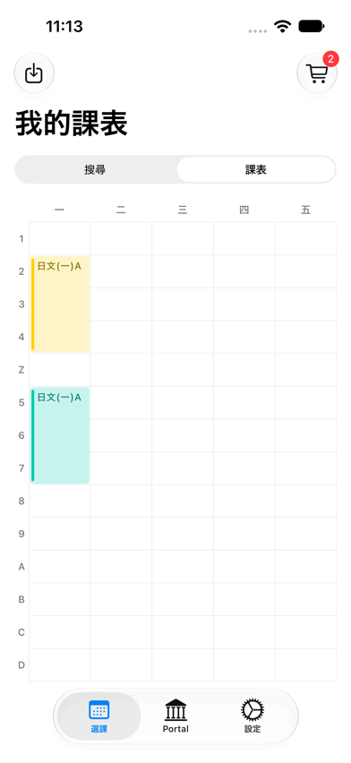
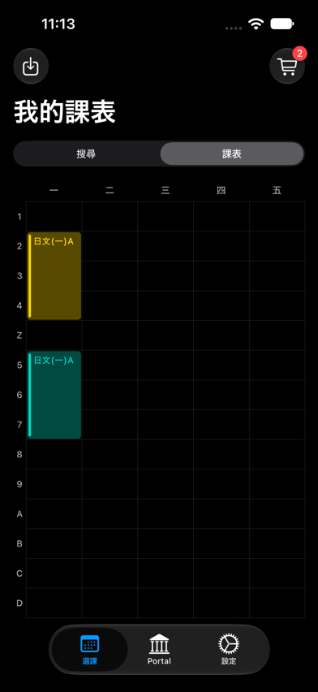

# Timetable colors

The Settings screen offers **依課程類別** (default) and **隨機配色**. This preference is shared by Android and iOS and persists in DataStore. The category legend includes only categories present in the draft and scrolls horizontally.

## Categories

Common categories take precedence over the general required/elective flag:

| Course-code prefix | Category | Palette hue |
| --- | --- | --- |
| CC | 核心通識 | Orange |
| GS | 通識選修 | Purple |
| MN | 國防通識 | Teal |
| CL0 | 共同國文 | Indigo |
| LN1 | 共同英文 | Pink |
| HI0 | 共同歷史 | Mint |
| PE | 體育 | Red |
| SC | 服務學習 | Cyan |
| ZZ | 預留時段 | Yellow |
| Other + required | 必修 | Blue |
| Other + elective | 選修 | Green |
| Other + unknown | 其他 | Neutral |

Prefix matching requires a following numeric character. CL and HI departmental courses and other LN courses do not automatically become common required courses. CC01–CC04 are search subject areas absent from CourseSummary; they are grouped under CC rather than inferred from titles. These are visual groupings, not graduation-credit rules or curriculum eligibility.

Sources: the supplied course-search screenshot, [NCU course map](https://course.ncu.edu.tw/p/412-1014-82.php?Lang=zh-tw), and [NCU course-selection instructions confirming CC/GS prefixes](https://course.ncu.edu.tw/static/file/14/1014/img/371/crs_info.pdf).

## Platform palettes

The iOS palette resolves UIColor system hues and background against the host view's traits. A zero-size accessibility-hidden UIKit observer refreshes the Compose palette on trait changes, including Increase Contrast; the selected app light/dark mode overrides only interface style. The block background remains softly tinted, while the resolved system hue supplies a leading marker and initial text color. Text shifts toward black or white only as much as needed to meet the WCAG sRGB contrast ratio of 4.5:1.

Android uses more saturated, fixed Material fills for the same eleven hues. Each fill gets whichever of black or white provides the stronger WCAG sRGB text contrast. This is an app-owned multi-hue palette, not wallpaper-generated system colors.

The shared timetable draws a continuous grid behind its cells, uses tighter 1 dp block insets, and places course titles at the top-left of each block.

Callers can supply `colorMode` and a nonempty `List<TimetableBlockColors>` to `CoursePlanningTimetableSuccessView` to override the defaults.

## Shuffle allocation and tracking

A semester-seeded permutation maps eleven slots to palette hues. The saved per-course map is keyed by serial number within the semester and survives UI state restoration. Repeated meeting blocks use the same assignment. Existing assignments, including removed courses, are retained while editing. Colors are not persisted with the course plan; a fresh application session rebuilds assignments from the current plan.

When assigning a new course, count live courses in each color slot and choose a least-used slot. Historical usage breaks ties, followed by permutation position. More than eleven courses reuse hues. Restoring a removed course retains its old color even if another course has since reused it, so existing colors are never changed solely to rebalance a plan. This can leave uneven counts after removals or restorations; subsequent new courses choose underused colors.

`timetableColorDistribution` counts active course identities per resolved palette hue, excluding removed courses and repeated meetings. The regression suite checks classification, stable assignments, allocation after removals, and distributions for 1, 6, 11, 22, and 33 courses across 1,000 synthetic semester seeds each.

Measured Kotlin test output is saved in [shuffle-distribution.csv](shuffle-distribution.csv). All initial plans have per-color counts differing by at most one. Eleven-course plans use each hue once; 22- and 33-course plans use each hue twice and three times respectively. Across 1,000 six-course plans, aggregate hue frequencies range from 522 to 576 (ideal: 545.45). These are synthetic algorithm measurements, not student data or analytics telemetry.

## Screenshot references

These captures show the populated timetable on an iPhone 15 simulator running iOS 27, in shuffled mode. LN0025-A and LN0025-B are separate course sections with the same title, so they have different course colors. Weekday and period labels remain readable, and periods C/D fit above the native tab bar.

| Light | Dark |
| --- | --- |
|  |  |

The supplied Apple Calendar and Google Calendar images informed the block and grid styling. These are iOS runtime captures; Android has build and palette-contrast verification but has not been visually checked on an emulator for this change.
